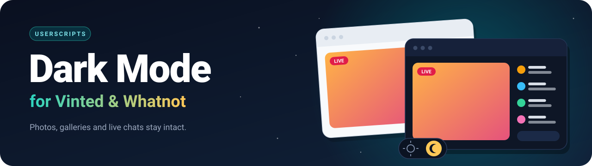
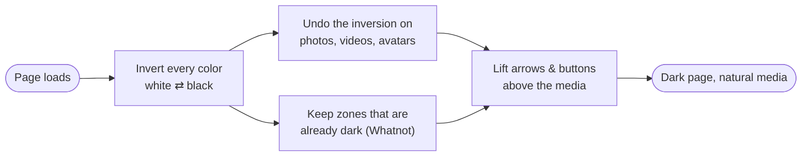

<p align="center">
  
</p>

<p align="center">
  <b>Two lightweight userscripts that turn Vinted and Whatnot dark</b><br>
  without breaking photos, galleries or live chats.
</p>

<p align="center">
  <a href="https://raw.githubusercontent.com/FlerkenMind/vinted-dark-mode/main/vinted-dark-mode.user.js"></a>
  &nbsp;
  <a href="https://raw.githubusercontent.com/FlerkenMind/vinted-dark-mode/main/whatnot-dark-mode.user.js"></a>
</p>

<p align="center">
  
  
  
  
  <a href="https://github.com/FlerkenMind/vinted-dark-mode/stargazers"></a>
</p>

<p align="center">
  <a href="#install">Install</a> &nbsp;·&nbsp;
  <a href="#whats-inside">What's inside</a> &nbsp;·&nbsp;
  <a href="#shortcuts">Shortcuts</a> &nbsp;·&nbsp;
  <a href="#how-it-works">How it works</a> &nbsp;·&nbsp;
  <a href="#troubleshooting">Troubleshooting</a> &nbsp;·&nbsp;
  <a href="#faq">FAQ</a>
</p>

<br>

<!--
  PREVIEW — uncomment once you have screenshots in /assets

<h2 align="center">Preview</h2>

<table>
  <tr>
    <td align="center"><b>Before</b></td>
    <td align="center"><b>After</b></td>
  </tr>
  <tr>
    <td></td>
    <td></td>
  </tr>
  <tr>
    <td></td>
    <td></td>
  </tr>
</table>
-->

## Install

**1. Get a userscript manager** (skip this if you already have one)

| Browser | Recommended manager |
| --- | --- |
| Chrome · Edge · Brave | [Tampermonkey](https://www.tampermonkey.net/) or [Violentmonkey](https://violentmonkey.github.io/) |
| Firefox · LibreWolf | [Tampermonkey](https://www.tampermonkey.net/) or [Violentmonkey](https://violentmonkey.github.io/) |

> [!IMPORTANT]
> **Chrome / Edge:** open `chrome://extensions`, go to your manager's **Details**, and turn on **Allow User Scripts**
> (some versions also require **Developer mode**). Without it, no userscript will run.

**2. Click an install button** at the top of this page, then confirm in your manager's tab.

**3. Reload Vinted or Whatnot.** That's it.

<br>

## What's inside

<table>
<tr>
<td width="50%" valign="top">

### Vinted Dark Mode
`v1.3.0`

- Dark theme on **every Vinted country site** (fr, de, es, it, nl, pt, co.uk, com…)
- Photos, videos and avatars are restored to look natural
- Applied before the page paints, so **no white flash**
- Gallery arrows stay **visible on top of photos**
- The full-screen photo viewer is left untouched
- Your on / off choice is remembered

</td>
<td width="50%" valign="top">

### Whatnot Dark Mode
`v1.0.0`

- **Light text on a dark background everywhere**, live chats included
- Already-dark areas (video stage, dark chat panels) are **detected and preserved**
- Pauses itself if the site is already dark
- Photos and videos keep their **exact colors** by default
- Optional **keep-hues** mode for the interface
- Buttons and arrows over video stay visible and clickable

</td>
</tr>
</table>

<br>

## Shortcuts

| Shortcut | Script | Action |
| --- | --- | --- |
| <kbd>Alt</kbd> + <kbd>Shift</kbd> + <kbd>D</kbd> | Vinted · Whatnot | Turn dark mode **on / off** (remembered) |
| <kbd>Alt</kbd> + <kbd>Shift</kbd> + <kbd>H</kbd> | Whatnot | Switch between the two **color modes** |

Both actions are also available from your userscript manager's menu (click its toolbar icon while on the site).

### Whatnot color modes

| Mode | Photos & video | Interface colors |
| --- | --- | --- |
| **Faithful photos** *(default)* | Exact colors | Hues become complementary (a red badge turns green) |
| **Keep hues** | Very saturated photos can look slightly washed out | Original hues are kept (red stays red) |

Pick whichever matters more to you. Your choice is remembered.

<br>

## How it works

Re-skinning a site class by class breaks every time the site ships an update. These scripts take a different route: they **invert the whole page**, then **undo the inversion** exactly where it would look wrong.



Dark text on a light background simply becomes light text on a dark background, which is why **chat messages turn white** without any per-site rules.

Because no site-specific class names are involved, the scripts keep working through most front-end redesigns.

<br>

## Troubleshooting

<details>
<summary><b>Nothing changes after installing</b></summary>

<br>

1. Make sure the script is **enabled** in your manager (click its icon while on the site).
2. **Chrome / Edge:** turn on **Allow User Scripts** (see [Install](#install)).
3. Private / incognito windows disable extensions by default. Allow your manager there if you need it.
4. Open the console (<kbd>F12</kbd> → **Console**). You should see a line starting with `[Vinted Dark Mode]` or `[Whatnot Dark Mode]`.
5. Press <kbd>Alt</kbd> + <kbd>Shift</kbd> + <kbd>D</kbd> in case it was switched off.

</details>

<details>
<summary><b>The page looks double-dark, or has strange colors</b></summary>

<br>

Disable any other dark-mode extension (Dark Reader, "force dark" flags…) on these sites. Two inversions cancel each other out.

</details>

<details>
<summary><b>A button, arrow or panel is missing or hard to read</b></summary>

<br>

Please [open an issue](https://github.com/FlerkenMind/vinted-dark-mode/issues/new) with:

- the page URL (or what you were doing),
- a screenshot,
- the lines printed in the console (<kbd>F12</kbd> → **Console**) that start with `[Vinted Dark Mode]` or `[Whatnot Dark Mode]`.

That is usually enough to fix it.

</details>

<br>

## Known limitations

- **Color-inversion approach:** some hues differ slightly from a native dark theme.
- **Vinted script:** very saturated photos can look slightly washed out. A faithful-photos mode like the Whatnot one is on the roadmap.
- **Emojis** inside inverted areas show inverted colors.
- **GPU load:** full-page filters can add a little work for your graphics card while a live stream plays. Turn the script off with <kbd>Alt</kbd> + <kbd>Shift</kbd> + <kbd>D</kbd> if your machine struggles.

<br>

## Privacy

These scripts **make no network requests and collect nothing**. They only inject CSS, read the page layout, and store your on / off preference locally through your userscript manager. The source is a single readable file per script, so you can check it yourself.

<br>

## FAQ

<details>
<summary><b>How do I update?</b></summary>

<br>

Click the install button again to get the latest version. Installing from a script hub such as Greasy Fork gives you automatic updates.

</details>

<details>
<summary><b>Can I use it on my phone?</b></summary>

<br>

The scripts target desktop browsers. Mobile support depends on your browser and userscript manager, and has not been tested here.

</details>

<details>
<summary><b>Why are some colors different from the original site?</b></summary>

<br>

Inverting colors is a general-purpose technique: it works everywhere, but it cannot match a hand-designed dark theme. See [Whatnot color modes](#whatnot-color-modes) for the trade-off.

</details>

<br>

## Contributing

Bug reports, screenshots and pull requests are welcome. If you add or change behavior, keep the scripts **dependency-free** and **readable** (no minification) so anyone can audit them.

```text
.
├── assets/
│   └── banner.svg
├── vinted-dark-mode.user.js
├── whatnot-dark-mode.user.js
├── LICENSE
└── README.md
```

<br>

## License

Released under the [MIT License](LICENSE).

> [!NOTE]
> This project is **not affiliated with, endorsed by, or sponsored by Vinted or Whatnot**.
> All product names and trademarks belong to their respective owners.

<br>

<p align="center">
  If this saved your eyes, consider leaving a ⭐<br>
  <sub>Made with care, one inverted pixel at a time.</sub>
</p>
